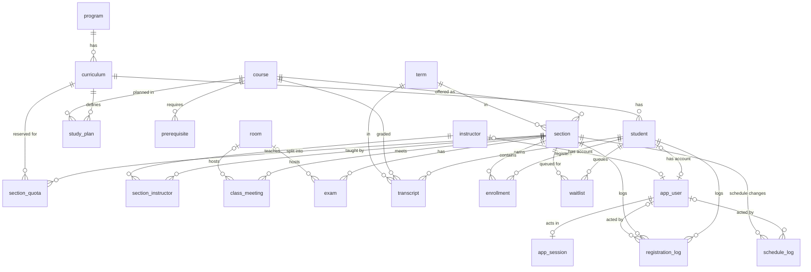

# Mini Project: ระบบวางแผนและตรวจสอบการลงทะเบียนตามแผนการเรียน (Study Plan–Aware Registration System)

ระบบฐานข้อมูล SQLite พร้อมหน้าเว็บ Flask สำหรับผู้ใช้ 3 บทบาท คือ นักศึกษา ฝ่ายทะเบียน และอาจารย์ผู้จัดตาราง กฎทางธุรกิจทั้งหมดอยู่ใน trigger ของฐานข้อมูล

## ปัญหา

จากข้อมูลจริงใน reg.cdti.ac.th ภาค 2/2569 (ตรวจซ้ำทีละรหัสวิชาเมื่อ 11 พ.ย. 2569)

1. **สอบหลายวิชาในวันเดียวกันโดยไม่มีการเตือน:** 04/03/70 สอบ 310-2311 เวลา 09:00–12:00 และ 910-1116 เวลา 13:00–16:00 ส่วน 09/03/70 สอบ 310-2309 เวลา 09:00–12:00 และ 312-3302 เวลา 13:00–16:00 เวลาไม่ทับกัน แต่ระบบเดิมไม่แจ้งตอนลงทะเบียน
2. **วิชาบังคับตามแผนลงไม่ได้เพราะเวลาเรียนชน:** วิชาบังคับในแผน 2/2569 สองวิชาชนกับวิชาที่ลงไว้แล้ว คือ 312-3302 (จ. 09:00–12:00) ชนกับ 310-3313 และ 310-3419 (พ. 09:00–12:00) ชนกับ 310-2205 ทั้งสองวิชาเปิดกลุ่มเดียว
3. **ที่นั่งถูกล็อกด้วยโควตาหลักสูตร:** 100-2102 แยกที่นั่ง :69 รับ 6 คน (เต็ม) กับ :65 รับ 30 คน (ลงแล้ว 15) ห้องเดียวกันยังว่าง 15 ที่ แต่นักศึกษาหลักสูตร 69 ลงไม่ได้
4. **วิชาค้างจากเทอมก่อน:** ไม่มีระบบเตือนว่าวิชาที่เลื่อนมาไปชนกับวิชาตามแผนเทอมนี้ กรณีจริงคือ 310-2205 (วิชาตามแผน 2/2568 ที่เลื่อนมาลงเทอมนี้) เรียน พ. 09:00–12:00 ตรงกับ 310-3419

## ผู้ใช้และสิ่งที่ทำได้

| ความสามารถ | นักศึกษา | ฝ่ายทะเบียน | ผู้จัดตาราง |
|---|:-:|:-:|:-:|
| ดูแผนการเรียน เหตุผลที่ลงไม่ได้ ตารางสอบ วิชาค้างที่ชน (R1–R3, R6) | ของตัวเอง | ทุกคน | – |
| ลง / ถอน / เข้าคิว | ของตัวเอง ในช่วงลงทะเบียน | แทนนักศึกษาได้ทุกเวลา | – |
| ตั้งช่วงลงทะเบียน เพดานหน่วยกิต ภาคปัจจุบัน | – | ✓ | – |
| เปิดกลุ่มเรียน ตั้งจำนวนรับและโควตาหลักสูตร จัดการคิว | – | ✓ | – |
| เพิ่มนักศึกษา จัดการบัญชีผู้ใช้ | – | ✓ | – |
| วางเวลาเรียน ห้อง อาจารย์ผู้สอน เวลาสอบ | – | ดูได้ | ✓ |
| รายงานฝ่ายทะเบียน (R4, R5, R7) | – | ✓ | – |
| รายงานจัดตาราง (R8 ห้อง, R9 ภาระสอน) | – | ✓ | ✓ |
| ประวัติการทำรายการ | ของตัวเอง | ✓ | ประวัติการแก้ตาราง |

## สิ่งที่ระบบทำ

| ความสามารถ | ทำด้วย |
|---|---|
| ห้ามลงวิชาที่เวลาเรียนหรือเวลาสอบชน | trigger `trg_enrollment_rules` + view `v_section_slot`, `v_student_slot` |
| ตรวจวิชาบังคับก่อน วิชาที่ผ่านแล้ว วิชาซ้ำ | trigger `trg_enrollment_rules` |
| ตรวจ capacity และโควตาตามหลักสูตร | view `v_seat_for_student` |
| หน่วยกิตรวมต่อภาคไม่เกินเพดาน (`term.max_credits`) | trigger `trg_enrollment_rules` + view `v_student_credits` |
| นักศึกษาลง/ถอน/เข้าคิวได้เฉพาะในช่วงลงทะเบียน | trigger `trg_enrollment_rules`, `trg_enrollment_before_drop`, `trg_waitlist_rules` + view `v_term_status`, `v_actor` |
| คิวสำรอง เรียงวิชาค้าง > วิชาบังคับเทอมนี้ > อื่นๆ และเลื่อนเฉพาะคนที่ลงได้จริง | view `v_waitlist_rank` (คอลัมน์ `eligible`), `v_waitlist_next` |
| มีคนถอน แล้วเลื่อนคนแรกในคิวที่ลงได้จริงขึ้นมาอัตโนมัติ | trigger `trg_enrollment_after_drop` |
| ลดจำนวนรับหรือโควตาต่ำกว่าคนที่ลงแล้วไม่ได้ | trigger `trg_section_capacity`, `trg_quota_before_insert/update` |
| วางคาบ: ห้องซ้ำไม่ได้, อาจารย์สอนสองที่ไม่ได้, ย้ายคาบไปชนกับนักศึกษาที่ลงแล้วไม่ได้ | trigger `trg_meeting_before_insert/update`, `trg_section_instructor_before_insert` + view `v_room_usage`, `v_instructor_busy` |
| จัดสอบ: ห้องสอบซ้ำไม่ได้, ห้องต้องจุพอ, นักศึกษาที่ลงแล้วต้องไม่สอบสองวิชาพร้อมกัน | trigger `trg_exam_before_insert/update` |
| ประวัติการลงทะเบียนและการแก้ตาราง พร้อมผู้ทำรายการ | ตาราง `registration_log`, `schedule_log` + trigger |
| รายงาน | `queries.sql` R1–R9 |

### ผู้ทำรายการ (`app_session`)

trigger ต้องรู้ว่าใครทำรายการ เช่น กฎช่วงลงทะเบียนใช้กับนักศึกษาแต่ไม่ใช้กับฝ่ายทะเบียน และประวัติต้องบันทึกผู้ทำ แอปจึงใส่แถวเดียวใน `app_session` ตอนเริ่มทุก transaction ที่แก้ข้อมูล แล้วลบออกก่อน commit SQLite เขียนได้ทีละ transaction จึงมีผู้ทำรายการได้ทีละคนเสมอ ถ้าไม่มีแถว (รันจาก sqlite3 โดยตรง) ถือเป็น "ระบบ" และไม่ติดกฎช่วงลงทะเบียน

แบ่งหน้าที่: **ฐานข้อมูล** ตรวจกฎทางธุรกิจ, **แอป** ตรวจสิทธิ์ (ใครเข้าหน้าไหน แก้ข้อมูลของใครได้) เช่น นักศึกษาทำรายการได้เฉพาะของตัวเองเพราะแอปใช้รหัสจาก session ไม่ได้รับจาก URL

## ER Diagram

ฉบับเต็ม 21 ตาราง: [Diagrams/registration-er.drawio](Diagrams/registration-er.drawio) (เปิดด้วย draw.io) และภาพ [Diagrams/registration-er.png](Diagrams/registration-er.png) ด้านล่างเป็นฉบับย่อ



## ตาราง (21 ตาราง)

| ตาราง | Primary key | หมายเหตุ |
|---|---|---|
| program | program_code | สาขาวิชา (ชื่อสาขาเก็บที่นี่ที่เดียว) |
| curriculum | curriculum_id | สาขา + ปีหลักสูตร (CPE63, BBA65, BBA69) |
| student | student_id | |
| course | course_code | |
| prerequisite | (course_code, prereq_code) | M:N ของ course กับตัวเอง |
| study_plan | (curriculum_id, course_code) | วิชาอยู่ชั้นปีไหน เทอมไหน บังคับหรือเลือก |
| term | term_id | มี `is_current = 1` ได้แถวเดียว (partial unique index), ช่วงลงทะเบียน, เพดานหน่วยกิต |
| section | section_id | UNIQUE (course_code, term_id, section_no) |
| section_quota | (section_id, curriculum_id) | ไม่มีแถว = ไม่จำกัดหลักสูตร |
| section_instructor | (section_id, instructor_id) | สอนร่วมหลายคนได้ |
| class_meeting | meeting_id | 1 section มีหลายช่วงเวลาได้ |
| exam | exam_id | UNIQUE (section_id, exam_type) |
| room, instructor | room_code, instructor_id | ความจุห้องใช้ตรวจห้องสอบ (NULL = ไม่ทราบ) |
| transcript | (student_id, course_code, term_id) | ลงซ้ำได้ถ้าได้ F/W |
| enrollment | (student_id, section_id) | สถานะปัจจุบัน ถอน = DELETE |
| waitlist | (student_id, section_id) | ลำดับคำนวณใน view ไม่ได้เก็บ |
| registration_log | log_id | ประวัติ ลงด้วย trigger เท่านั้น พร้อม `actor_user_id` |
| app_user | user_id | บัญชีผู้ใช้ รหัสผ่านเก็บเป็น hash; นักศึกษาต้องผูก `student_id` (CHECK) |
| app_session | id (= 1 เสมอ) | ผู้ทำรายการใน transaction ปัจจุบัน |
| schedule_log | log_id | ประวัติการแก้เวลาเรียน เวลาสอบ อาจารย์ผู้สอน ลงด้วย trigger เท่านั้น |

## Normalization

- **1NF:** เวลาเรียนหลายช่วง (จ./อ./พฤ. 08:00–09:00) แยกเป็นตาราง `class_meeting` และอาจารย์หลายคนแยกเป็น `section_instructor` แทนการเก็บเป็นข้อความเดียว
- **2NF:** `study_plan` มี key (curriculum_id, course_code) และไม่เก็บชื่อวิชาหรือหน่วยกิต ซึ่งขึ้นกับ course_code อย่างเดียว
- **3NF:** ชื่อสาขาขึ้นกับ `program_code` ไม่ได้ขึ้นกับ `curriculum_id` โดยตรง จึงแยกเป็นตาราง `program` ไม่เก็บซ้ำในทุกปีหลักสูตร และไม่เก็บจำนวนคนลง ที่ว่าง หรือหน่วยกิตรวมไว้ในตาราง (คำนวณใน `v_section_seat`, `v_student_credits`) ลำดับคิวก็คำนวณใน `v_waitlist_rank` จึงไม่มีค่าที่อาจไม่ตรงกับข้อมูลจริง `app_session` เก็บแค่ `user_id` ส่วนบทบาทอ่านจาก `app_user` ผ่าน view `v_actor`
- **จุดที่ยอมซ้ำ:** `course.credit_pattern` มีหน่วยกิตซ้ำกับ `credits` เก็บไว้เพื่อแสดงผลเหมือนใน reg และ `schedule_log.detail` เก็บข้อความของค่าก่อน/หลังแก้ไว้ เพราะเป็นประวัติที่ต้องไม่เปลี่ยนตามข้อมูลปัจจุบัน

## Transaction และการแย่งที่นั่ง

SQLite ให้เขียนได้ทีละ transaction เดียว ตรวจที่นั่งแล้ว insert จึงไม่มีทางแทรกกัน ถ้าย้ายไป PostgreSQL หรือ MySQL ต้องล็อกแถว section ก่อนนับที่นั่ง ไม่เช่นนั้นสองคนอาจได้ที่นั่งสุดท้ายพร้อมกัน (lost update) และต้องเปลี่ยน `app_session` เป็นตัวแปรระดับ session ของฐานข้อมูล (เช่น `SET LOCAL app.user_id` ใน PostgreSQL)

```sql
BEGIN;
SELECT capacity FROM section WHERE section_id = 1 FOR UPDATE;  -- คนที่สองรอตรงนี้
-- นับ enrollment แล้ว INSERT
COMMIT;
```

## วิธีรัน

### ฐานข้อมูลและรายงาน (sqlite3 command line)

รันจากโฟลเดอร์ `Mini_Project_PlanA` ใช้ได้กับ sqlite3 ตั้งแต่ 3.25 ขึ้นไป (ทดสอบกับ 3.29 แล้ว)

```bash
sqlite3 :memory: ".read run.sql"
```

`demo.sql` ข้อ D1, D2, D3, D5, D6, D9, D11–D17 ตั้งใจให้ขึ้น error (รวม 13 ครั้ง) เพื่อแสดงว่า trigger กันได้ ส่วน D18 แสดงว่าคนในคิวที่ลงไม่ได้ (หน่วยกิตเกิน) ถูกข้ามไป และการถอนไม่พัง ถ้าต้องการเก็บเป็นไฟล์ฐานข้อมูล ให้ใช้ `sqlite3 registration.db ".read run.sql"`

### หน้าเว็บ (Flask)

```bash
pip install -r web/requirements.txt
python web/app.py
```

แล้วเปิด http://127.0.0.1:5000 ครั้งแรกระบบจะสร้าง `web/registration.db` จาก `schema.sql` + `seed.sql` ให้เอง บัญชีทดสอบ (admin, scheduler และนักศึกษาที่ username = รหัสนักศึกษา) และรหัสผ่านทดสอบเขียนไว้ท้าย `seed.sql` ฝ่ายทะเบียนมีปุ่ม "รีเซ็ตข้อมูลสาธิต" ในหน้าภาพรวม

| บทบาท | หน้า |
|---|---|
| นักศึกษา | `/me` ลงทะเบียน (R1–R3, R6 และปุ่มลง/ถอน/เข้าคิว), `/me/log` ประวัติของตัวเอง |
| ฝ่ายทะเบียน | `/admin` ภาพรวม (R4, R5, คิว), `/admin/students` นักศึกษาและการทำรายการแทน, `/admin/sections` กลุ่มเรียน โควตา คิว, `/admin/terms` ภาคเรียน, `/admin/users` บัญชีผู้ใช้, `/admin/credits` R7, `/admin/log` ประวัติ |
| ผู้จัดตาราง | `/schedule` เวลาเรียน อาจารย์ เวลาสอบ, `/schedule/rooms` R8, `/schedule/instructors` R9, `/schedule/log` ประวัติการแก้ตาราง |

หน้าเว็บไม่ตรวจกฎทางธุรกิจเอง ส่งคำสั่งไปที่ฐานข้อมูลตรงๆ ถ้าผิดกฎ trigger จะ `RAISE(ABORT, ...)` แล้วหน้าเว็บแสดงข้อความนั้น ความปลอดภัย: รหัสผ่านเก็บเป็น hash (pbkdf2), ทุกฟอร์มมี CSRF token, ตรวจบทบาททุกหน้า, กัน open redirect หลัง login

ลองตามกรณีจริง: login เป็น `6799000001` แล้วกด "ลอง" ที่ 310-3419 (ชนกับวิชาค้าง 310-2205) หรือ login เป็น `scheduler` แล้วย้าย 310-2205 ไปวันศุกร์ แล้วกลับไปดูว่า 6799000001 ลง 310-3419 ได้หรือไม่ (ได้เวลาแล้ว แต่หน่วยกิตจะเกินเพดาน 22)

### ทดสอบ

```bash
python -m unittest discover -s web -v
```

25 ข้อ: สิทธิ์ของแต่ละบทบาท, CSRF, open redirect, บัญชีที่ปิดแล้ว, ช่วงลงทะเบียน, ที่นั่ง/โควตา/เลื่อนคิว, กฎจัดตารางและจัดสอบ (ใช้ฐานข้อมูลชั่วคราว ไม่แตะ `web/registration.db`)

### ไฟล์

| ไฟล์ | เนื้อหา |
|---|---|
| `schema.sql` | 21 ตาราง, 14 view, 22 trigger |
| `seed.sql` | ข้อมูลรายวิชา/แผน/ตาราง ภาค 2/2569 จาก reg + นักศึกษาสมมุติ + บัญชีทดสอบ |
| `queries.sql` | รายงาน R1–R9 |
| `demo.sql` | ตัวอย่างสาธิต D1–D18 |
| `run.sql` | รันทั้งชุด |
| `registration.db` | ฐานข้อมูลสำเร็จรูป (schema + seed ยังไม่รัน demo) เปิดด้วย DB Browser for SQLite หรือ `sqlite3 registration.db` |
| `registration_tables.xlsx` | ข้อมูลตั้งต้นทั้ง 21 ตาราง ชีตละตาราง พร้อมชีตสารบัญ |
| `csv/` | ข้อมูลตั้งต้นทั้ง 21 ตาราง ไฟล์ละตาราง (UTF-8 BOM เปิดใน Excel แล้วภาษาไทยไม่เพี้ยน) |
| `web/` | หน้าเว็บ Flask: `app.py` (login, CSRF), `core.py` (ฐานข้อมูลและผู้ทำรายการ), `views_student.py`, `views_admin.py`, `views_scheduler.py`, `reports.py` (SQL), `templates/`, `test_app.py` |
| `docs/PLAN.md` | แผนออกแบบระบบ 3 บทบาท |
| `docs/SUMMARY.md` | สรุปงานล่าสุดและงานที่เหลือ |
| `proposal_form.md` | คำตอบสำหรับฟอร์มเสนอหัวข้อ ข้อ 3–6 |
| `Diagrams/` | ER diagram 21 ตาราง: `registration-er.drawio` (แก้ไขด้วย draw.io) และภาพ `registration-er.png` |
| `archive/v2/` | ร่างส่วนขยายฝ่ายจัดตารางรุ่นก่อน (มีเวลาว่างอาจารย์และการล็อกวิชาส่วนกลาง) เก็บไว้อ้างอิง |

## ที่มาของข้อมูล

- รายวิชา แผนการเรียน CPE63 เวลาเรียน/สอบ จำนวนรับ: reg.cdti.ac.th ภาค 2/2569 (ตรวจซ้ำทีละรหัสวิชาเมื่อ 11 พ.ย. 2569 จำนวนคนลงอาจเปลี่ยนได้อีก)
- 310-3313 ยังไม่มีวันสอบปลายภาคใน reg จึงไม่ได้ใส่ข้อมูลสอบ `demo.sql` ข้อ D3 เปิดกลุ่มสาธิต 02 พร้อมวันสอบสมมุติเพื่อสาธิตกฎเวลาสอบชน
- วิชาบังคับก่อน 310-3416 → 310-2101, รหัสหลักสูตร BBA, ช่วงลงทะเบียน, เพดาน 22 หน่วยกิต และบัญชีผู้ใช้ทั้งหมด เป็นข้อมูลสมมุติเพื่อสาธิต
- นักศึกษาทุกคนเป็นข้อมูลสมมุติ คนที่ลงไม่ครบตามจำนวนใน reg ให้นักศึกษาจำลองหลักสูตร `EXT` มาเติม

## ข้อจำกัด

- **กลุ่มที่จำกัดตามกลุ่มเรียน:** reg มีกลุ่มที่รับเฉพาะบางกลุ่มเรียน เช่น 910-1116 กลุ่ม 01 "เฉพาะ 67วค." และกลุ่ม 03 "เฉพาะ 69กว." (รับ 4 คน เต็มแล้ว ขณะที่กลุ่ม 02 ซึ่งเรียนห้องและเวลาเดียวกันยังว่าง 12 ที่) ตาราง `section_quota` จำกัดได้ตามหลักสูตรเท่านั้น จึงยังไม่ได้จำลองกรณีนี้ และข้อมูลตัวอย่างใส่เฉพาะกลุ่ม 01
- **ช่วงลงทะเบียนมีช่วงเดียว:** ยังไม่แยกช่วงลงทะเบียนปกติกับช่วงเพิ่ม-ถอน
- **ผู้จัดตารางยังไม่มีเวลาว่างของอาจารย์และการล็อกวิชาส่วนกลาง:** มีร่างไว้ใน `archive/v2/`
- **ไม่มีบทบาทอาจารย์ทั่วไป:** เช่น ดูรายชื่อนักศึกษาในกลุ่มที่สอน
- **หน้าเว็บเป็นแบบชั่วคราว:** รอบนี้เน้นตัวระบบ UX/UI จะออกแบบใหม่
- **โหมด debug:** `python web/app.py` เปิด debug และฟังเฉพาะ 127.0.0.1 ใช้สาธิตในเครื่องเท่านั้น ถ้าจะใช้จริงต้องปิด debug และเปลี่ยนบัญชีทดสอบทั้งหมด

## ต่อยอดได้

- รองรับกลุ่มที่จำกัดตามกลุ่มเรียน (เพิ่มตารางกลุ่มเรียนและโควตาตามกลุ่ม)
- คืนที่นั่งโควตาที่ไม่มีคนใช้หลังวันที่กำหนด แล้วให้คิวขยับ (ตอนนี้ฝ่ายทะเบียนแก้โควตาเองได้ และคิวขยับทันที)
- แนะนำ section ที่ไม่ชนกัน ให้ครบทุกวิชาในแผน (recursive CTE)
- ช่วงเพิ่ม-ถอน, บทบาทอาจารย์ทั่วไป, เวลาว่างของอาจารย์
