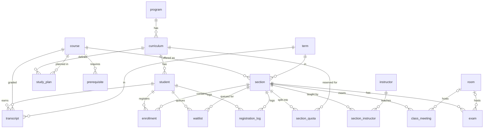

# Mini Project: ระบบวางแผนและตรวจสอบการลงทะเบียนตามแผนการเรียน (Study Plan–Aware Registration System)

## ปัญหา

จากข้อมูลจริงใน reg.cdti.ac.th ภาค 2/2569 (ตรวจซ้ำทีละรหัสวิชาเมื่อ 11 พ.ย. 2569)

1. **สอบหลายวิชาในวันเดียวกันโดยไม่มีการเตือน:** 04/03/70 สอบ 310-2311 เวลา 09:00–12:00 และ 910-1116 เวลา 13:00–16:00 ส่วน 09/03/70 สอบ 310-2309 เวลา 09:00–12:00 และ 312-3302 เวลา 13:00–16:00 เวลาไม่ทับกัน แต่ระบบเดิมไม่แจ้งตอนลงทะเบียน
2. **วิชาบังคับตามแผนลงไม่ได้เพราะเวลาเรียนชน:** วิชาบังคับในแผน 2/2569 สองวิชาชนกับวิชาที่ลงไว้แล้ว คือ 312-3302 (จ. 09:00–12:00) ชนกับ 310-3313 และ 310-3419 (พ. 09:00–12:00) ชนกับ 310-2205 ทั้งสองวิชาเปิดกลุ่มเดียว
3. **ที่นั่งถูกล็อกด้วยโควตาหลักสูตร:** 100-2102 แยกที่นั่ง :69 รับ 6 คน (เต็ม) กับ :65 รับ 30 คน (ลงแล้ว 15) ห้องเดียวกันยังว่าง 15 ที่ แต่นักศึกษาหลักสูตร 69 ลงไม่ได้
4. **วิชาค้างจากเทอมก่อน:** ไม่มีระบบเตือนว่าวิชาที่เลื่อนมาไปชนกับวิชาตามแผนเทอมนี้ กรณีจริงคือ 310-2205 (วิชาตามแผน 2/2568 ที่เลื่อนมาลงเทอมนี้) เรียน พ. 09:00–12:00 ตรงกับ 310-3419

## สิ่งที่ระบบทำ

| ความสามารถ | ทำด้วย |
|---|---|
| ห้ามลงวิชาที่เวลาเรียนหรือเวลาสอบชน | trigger `trg_enrollment_rules` + view `v_section_slot`, `v_student_slot` |
| ตรวจวิชาบังคับก่อน วิชาที่ผ่านแล้ว วิชาซ้ำ | trigger `trg_enrollment_rules` |
| ตรวจ capacity และโควตาตามหลักสูตร | view `v_seat_for_student` |
| คิวสำรอง เรียงวิชาค้าง > วิชาบังคับเทอมนี้ > อื่นๆ | view `v_waitlist_rank` |
| มีคนถอน แล้วเลื่อนคนแรกในคิวที่ลงได้จริงขึ้นมาอัตโนมัติ | trigger `trg_enrollment_after_drop` |
| ประวัติการทำรายการ (ลง/ถอน/เข้าคิว/เลื่อนจากคิว) | ตาราง `registration_log` + trigger |
| รายงานแผนการเรียนเทียบกับที่ลงจริง และบอกเหตุผลที่ลงไม่ได้ | `queries.sql` R1, R2 |
| เตือนวันที่ต้องสอบหลายวิชา | `queries.sql` R3 |
| ฝ่ายทะเบียน: ความต้องการที่นั่งเทียบกับที่เปิด, ที่นั่งที่ถูกล็อกด้วยโควตา | `queries.sql` R4, R5 |
| วิชาค้างที่ชนกับวิชาบังคับตามแผนเทอมนี้ | `queries.sql` R6 |

## ER Diagram

ฉบับเต็ม 18 ตาราง: [Diagrams/registration-er.drawio](Diagrams/registration-er.drawio) (เปิดด้วย draw.io) และภาพ [Diagrams/registration-er.png](Diagrams/registration-er.png) ด้านล่างเป็นฉบับย่อ



## ตาราง (18 ตาราง)

| ตาราง | Primary key | หมายเหตุ |
|---|---|---|
| program | program_code | สาขาวิชา (ชื่อสาขาเก็บที่นี่ที่เดียว) |
| curriculum | curriculum_id | สาขา + ปีหลักสูตร (CPE63, BBA65, BBA69) |
| student | student_id | |
| course | course_code | |
| prerequisite | (course_code, prereq_code) | M:N ของ course กับตัวเอง |
| study_plan | (curriculum_id, course_code) | วิชาอยู่ชั้นปีไหน เทอมไหน บังคับหรือเลือก |
| term | term_id | มี `is_current = 1` ได้แถวเดียว (partial unique index) |
| section | section_id | UNIQUE (course_code, term_id, section_no) |
| section_quota | (section_id, curriculum_id) | ไม่มีแถว = ไม่จำกัดหลักสูตร |
| section_instructor | (section_id, instructor_id) | สอนร่วมหลายคนได้ |
| class_meeting | meeting_id | 1 section มีหลายช่วงเวลาได้ |
| exam | exam_id | UNIQUE (section_id, exam_type) |
| room, instructor | room_code, instructor_id | |
| transcript | (student_id, course_code, term_id) | ลงซ้ำได้ถ้าได้ F/W |
| enrollment | (student_id, section_id) | สถานะปัจจุบัน ถอน = DELETE |
| waitlist | (student_id, section_id) | ลำดับคำนวณใน view ไม่ได้เก็บ |
| registration_log | log_id | ประวัติ ลงด้วย trigger เท่านั้น |

## Normalization

- **1NF:** เวลาเรียนหลายช่วง (จ./อ./พฤ. 08:00–09:00) แยกเป็นตาราง `class_meeting` และอาจารย์หลายคนแยกเป็น `section_instructor` แทนการเก็บเป็นข้อความเดียว
- **2NF:** `study_plan` มี key (curriculum_id, course_code) และไม่เก็บชื่อวิชาหรือหน่วยกิต ซึ่งขึ้นกับ course_code อย่างเดียว
- **3NF:** ชื่อสาขาขึ้นกับ `program_code` ไม่ได้ขึ้นกับ `curriculum_id` โดยตรง จึงแยกเป็นตาราง `program` ไม่เก็บซ้ำในทุกปีหลักสูตร และไม่เก็บจำนวนคนลงหรือที่ว่างในตาราง `section` (คำนวณใน `v_section_seat`) ลำดับคิวก็คำนวณใน `v_waitlist_rank` จึงไม่มีค่าที่อาจไม่ตรงกับข้อมูลจริง
- **จุดที่ยอมซ้ำ:** `course.credit_pattern` มีหน่วยกิตซ้ำกับ `credits` เก็บไว้เพื่อแสดงผลเหมือนใน reg

## Transaction และการแย่งที่นั่ง

SQLite ให้เขียนได้ทีละ transaction เดียว ตรวจที่นั่งแล้ว insert จึงไม่มีทางแทรกกัน ถ้าย้ายไป PostgreSQL หรือ MySQL ต้องล็อกแถว section ก่อนนับที่นั่ง ไม่เช่นนั้นสองคนอาจได้ที่นั่งสุดท้ายพร้อมกัน (lost update)

```sql
BEGIN;
SELECT capacity FROM section WHERE section_id = 1 FOR UPDATE;  -- คนที่สองรอตรงนี้
-- นับ enrollment แล้ว INSERT
COMMIT;
```

## วิธีรัน

### ฐานข้อมูลและรายงาน (sqlite3 command line)

รันจากโฟลเดอร์ `Mini_Project_PlanA` ใช้ได้กับ sqlite3 ตั้งแต่ 3.25 ขึ้นไป (ทดสอบกับ 3.29 แล้ว)

```bash
sqlite3 :memory: ".read run.sql"
```

ข้อ D1, D2, D3, D5, D6, D9 ใน `demo.sql` ตั้งใจให้ขึ้น error (รวม 6 ครั้ง) เพื่อแสดงว่า trigger กันได้ ถ้าต้องการเก็บเป็นไฟล์ฐานข้อมูล ให้ใช้ `sqlite3 registration.db ".read run.sql"`

### หน้าเว็บ (Flask)

```bash
pip install -r web/requirements.txt
python web/app.py
```

แล้วเปิด http://127.0.0.1:5000 ครั้งแรกระบบจะสร้าง `web/registration.db` จาก `schema.sql` + `seed.sql` ให้เอง ปุ่ม "รีเซ็ตข้อมูล" มุมขวาบนใช้ล้างสิ่งที่ทดลองทำแล้วกลับไปเป็นข้อมูลตั้งต้น

| หน้า | เนื้อหา |
|---|---|
| นักศึกษา (`/student/<รหัส>`) | R1 แผนเทียบกับที่ลงจริง, R2 เหตุผลที่ลงไม่ได้, R3 ตารางสอบพร้อมเตือนวันที่สอบหลายวิชา, R6 วิชาค้างที่ชน, ปุ่มลงทะเบียน/ถอน/เข้าคิว |
| ฝ่ายทะเบียน (`/registrar`) | R4 ความต้องการที่นั่ง, R5 ที่นั่งถูกล็อกด้วยโควตา, ลำดับคิวสำรอง, ที่นั่งรายกลุ่มเรียน |
| ประวัติ (`/log`) | `registration_log` กรองตามนักศึกษาและประเภทรายการได้ |

หน้าเว็บไม่มีการตรวจกฎเองเลย ปุ่มต่างๆ ส่ง `INSERT`/`DELETE` ไปที่ฐานข้อมูลตรงๆ ถ้าผิดกฎ trigger จะ `RAISE(ABORT, ...)` และหน้าเว็บแสดงข้อความนั้นให้ผู้ใช้เห็น การเลื่อนคนจากคิวเมื่อมีคนถอนก็ทำโดย trigger `trg_enrollment_after_drop`

ลองตามกรณีจริง: เปิด `6799000001` แล้วกด "ลอง" ที่ 310-3419 (ชนกับวิชาค้าง 310-2205) หรือเปิด `B6907` แล้วลอง 100-2102 (โควตา :69 เต็ม)

### ไฟล์

| ไฟล์ | เนื้อหา |
|---|---|
| `schema.sql` | ตาราง, view, trigger |
| `seed.sql` | ข้อมูลรายวิชา/แผน/ตาราง ภาค 2/2569 จาก reg + นักศึกษาสมมุติ |
| `queries.sql` | รายงาน R1–R6 |
| `demo.sql` | ตัวอย่างสาธิต D1–D10 |
| `run.sql` | รันทั้งชุด |
| `registration.db` | ฐานข้อมูลสำเร็จรูป (schema + seed ยังไม่รัน demo) เปิดด้วย DB Browser for SQLite หรือ `sqlite3 registration.db` |
| `registration_tables.xlsx` | ข้อมูลตั้งต้นทั้ง 18 ตาราง ชีตละตาราง พร้อมชีตสารบัญ (ลิงก์ไปแต่ละชีต คำอธิบาย จำนวนแถว primary key) |
| `csv/` | ข้อมูลตั้งต้นทั้ง 18 ตาราง ไฟล์ละตาราง (UTF-8 BOM เปิดใน Excel แล้วภาษาไทยไม่เพี้ยน) |
| `web/` | หน้าเว็บ Flask (`app.py`, SQL ของรายงานใน `reports.py`, `templates/`) |
| `proposal_form.md` | คำตอบสำหรับฟอร์มเสนอหัวข้อ ข้อ 3–6 |
| `Diagrams/` | ER diagram 18 ตาราง: `registration-er.drawio` (แก้ไขด้วย draw.io) และภาพ `registration-er.png` |
| `archive/v2/` | ส่วนขยายฝ่ายจัดตาราง/จัดสอบ (v2) ที่ตัดออกจากขอบเขต เก็บไว้อ้างอิงเท่านั้น |

## ที่มาของข้อมูล

- รายวิชา แผนการเรียน CPE63 เวลาเรียน/สอบ จำนวนรับ: reg.cdti.ac.th ภาค 2/2569 (ตรวจซ้ำทีละรหัสวิชาเมื่อ 11 พ.ย. 2569 จำนวนคนลงอาจเปลี่ยนได้อีก)
- 310-3313 ยังไม่มีวันสอบปลายภาคใน reg จึงไม่ได้ใส่ข้อมูลสอบ วันสอบสมมุติของวิชานี้มีเฉพาะใน `demo.sql` ข้อ D3 เพื่อสาธิตกฎเวลาสอบชน
- วิชาบังคับก่อน 310-3416 → 310-2101 และรหัสหลักสูตร BBA เป็นข้อมูลสมมุติเพื่อสาธิต
- นักศึกษาทุกคนเป็นข้อมูลสมมุติ คนที่ลงไม่ครบตามจำนวนใน reg ให้นักศึกษาจำลองหลักสูตร `EXT` มาเติม

## ข้อจำกัด

- **กลุ่มที่จำกัดตามกลุ่มเรียน:** reg มีกลุ่มที่รับเฉพาะบางกลุ่มเรียน เช่น 910-1116 กลุ่ม 01 "เฉพาะ 67วค." และกลุ่ม 03 "เฉพาะ 69กว." (รับ 4 คน เต็มแล้ว ขณะที่กลุ่ม 02 ซึ่งเรียนห้องและเวลาเดียวกันยังว่าง 12 ที่) ตาราง `section_quota` จำกัดได้ตามหลักสูตรเท่านั้น จึงยังไม่ได้จำลองกรณีนี้ และข้อมูลตัวอย่างใส่เฉพาะกลุ่ม 01
- **ตรวจชนเฉพาะตอนลงทะเบียน:** ถ้าเวลาเรียนหรือเวลาสอบถูกแก้หลังจากมีคนลงแล้ว ระบบไม่ตรวจย้อนหลังให้
- **ไม่รวมงานฝ่ายจัดตาราง/จัดสอบ:** เช่น เวลาว่างอาจารย์ ห้องซ้ำ ล็อกวิชาส่วนกลาง อยู่นอกขอบเขต (ฉบับร่างเก็บไว้ใน `archive/v2/`)
- **หน้าเว็บไม่มีระบบ login:** เลือกนักศึกษาจากรหัสได้เลย เพราะใช้สาธิตเท่านั้น

## ต่อยอดได้

- รองรับกลุ่มที่จำกัดตามกลุ่มเรียน (เพิ่มตารางกลุ่มเรียนและโควตาตามกลุ่ม)
- คืนที่นั่งโควตาที่ไม่มีคนใช้หลังวันที่กำหนด (UPDATE `section_quota`) แล้วให้คิวขยับ
- แนะนำ section ที่ไม่ชนกัน ให้ครบทุกวิชาในแผน (recursive CTE)
- ระบบ login แยกสิทธิ์นักศึกษากับฝ่ายทะเบียน
